  <picture>
    <source media="(prefers-color-scheme: dark)" srcset="./header-dark.svg">
    <source media="(prefers-color-scheme: light)" srcset="./header-light.svg">
    
  </picture>

 

### `whoami`

Pemecut AI. Bukan nulis boilerplate manual dari nol, tapi mengarahkan, mengevaluasi, dan memaksa model AI sampai menghasilkan software yang benar-benar jalan dan siap pakai.

- **Fokus utama**: Desktop utilities, tactile interfaces, tools produktivitas, dan eksperimen web interaktif.
- **Filosofi stack**: Tergantung AI. Mau Python, C++, TypeScript, atau Go, yang penting masalah selesai, performa optimal, dan aplikasinya ter-deliver.

---

### Featured Works

Daftar proyek pilihan yang dirancang dan di-ship secara nyata:

| Proyek | Deskripsi | Tech & Ekosistem |
| :--- | :--- | :--- |
| **[Vision-pill](https://github.com/pikri-beep/Vision-pill)** | Dynamic Island app interaktif untuk Windows | C++, JavaScript, C#, CSS |
| **[PocketDesk Remote](https://github.com/pikri-beep/pocketdesk-remote)** | All-in-one local desktop controller dengan tactile mobile UI | Python, Web, Hardware Control |
| **[SnapMoment](https://github.com/FauzanZuhri/SnapMoment)** | Digital self-photobooth bergaya Neo-Brutalism dengan live motion photo | React, TypeScript, Vite, WebRTC |
| **[Jarvis](https://github.com/pikri-beep/jarvis)** | Otomasi desktop dan asisten personal berbasis script lokal | Python, Batchfile |

---

### Toolkit & Workflow

Alat yang benar-benar dipakai sehari-hari untuk meracik dan mengorkestrasi sistem:

- **AI Orchestration**: Antigravity, Claude, Gemini CLI
- **Language Spectrum**: Python, JavaScript / TypeScript, C++, C#
- **Platform & Runtime**: Windows, Node.js, WebRTC, Native Canvas
- **Source Control**: Git & GitHub CLI

---

### Diskusi & Kolaborasi

Punya ide proyek, feedback, atau ingin berdiskusi seputar AI-driven development?
Silakan buka issue atau discussion langsung di repositori terkait.
